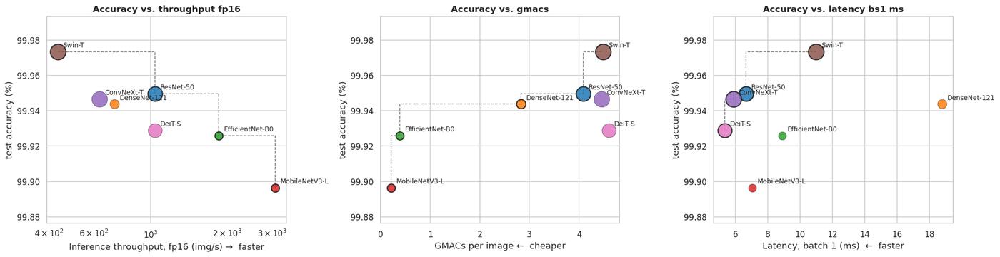
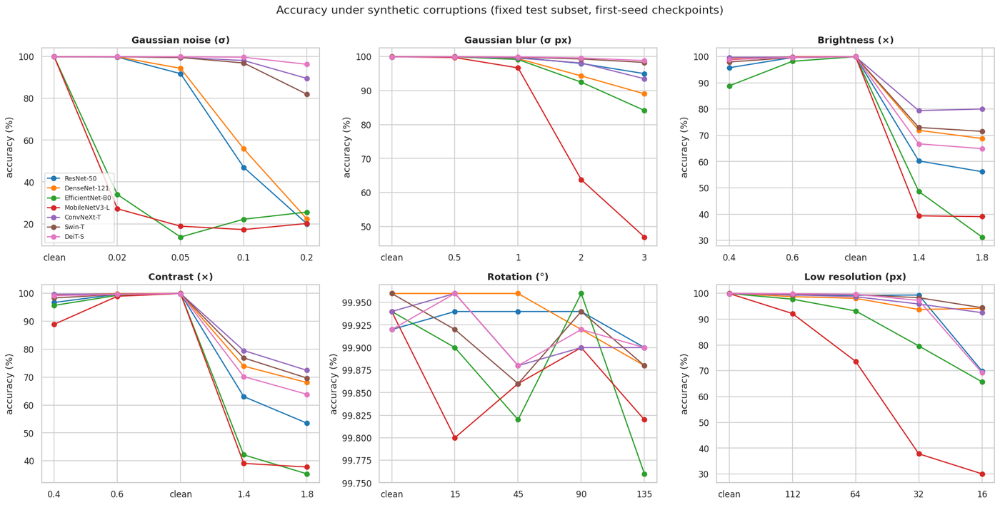
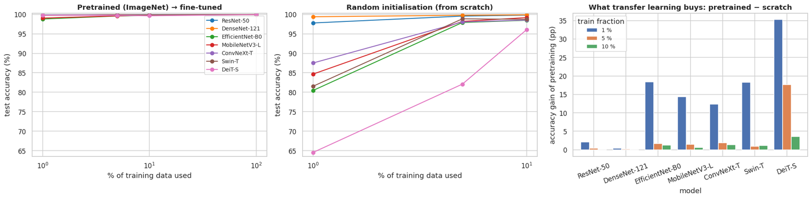
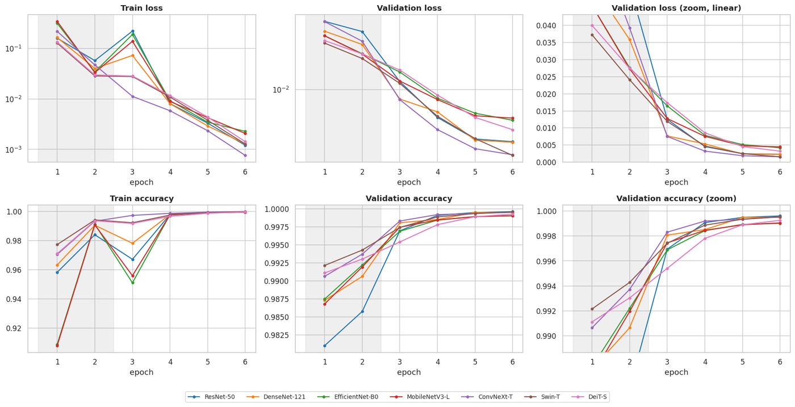
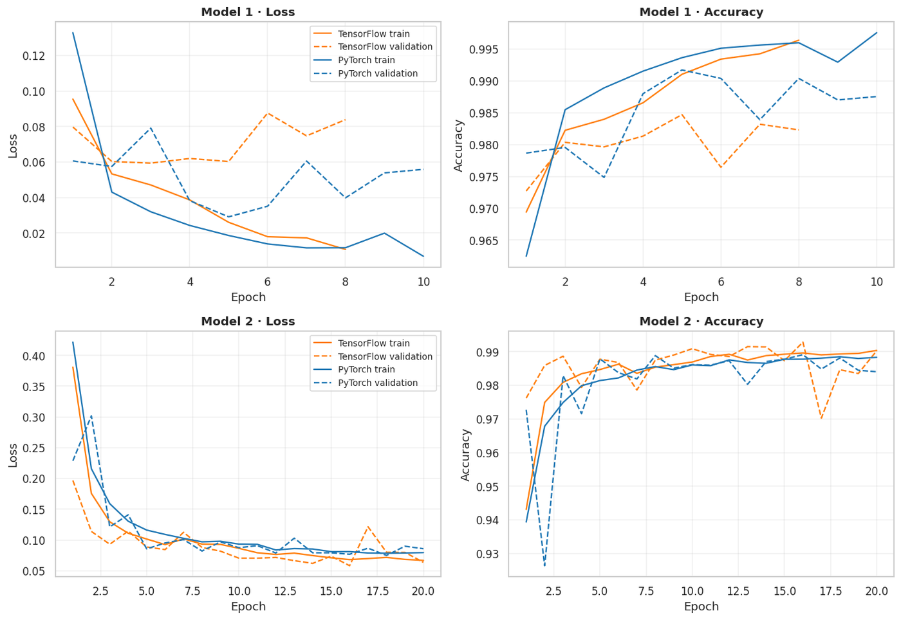
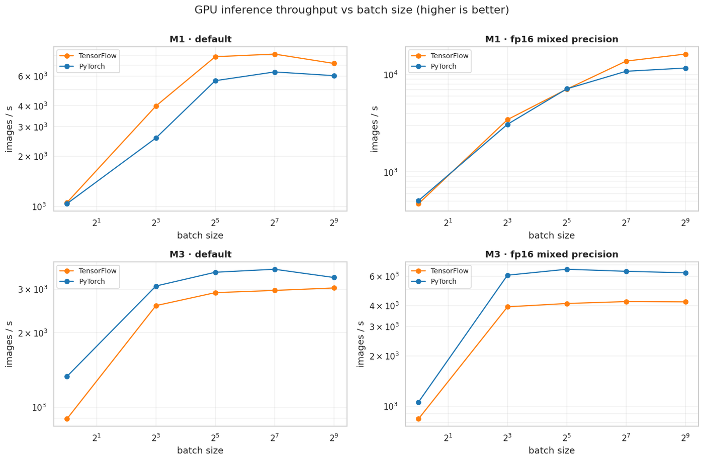

# 🌾 Rice Variety Classification

> **From small CNNs and a TensorFlow vs PyTorch comparison to a 7-backbone transfer-learning benchmark for rice variety classification**


---

## 🔰 Overview
This repository contains **two complete studies on the same task and the same data**: classifying a single rice grain image into one of **5 varieties** (Arborio, Basmati, Ipsala, Jasmine, Karacadag).

Accuracy on this dataset is close to saturated, so both notebooks ask a more informative question than "which model is most accurate?":

1. **Framework comparison** → *Do TensorFlow/Keras and PyTorch behave differently* when the same CNNs are built, trained and benchmarked under identical conditions?  
2. **Transfer-learning benchmark** → *Which pretrained backbone gives the best trade-off* between accuracy, reliability, speed, size, robustness and data-efficiency?

Compared in the transfer-learning study (all ImageNet-1k pretrained):

- 🧱 ResNet-50  
- 🕸️ DenseNet-121  
- ⚡ EfficientNet-B0  
- 📱 MobileNetV3-Large  
- 🔲 ConvNeXt-Tiny  
- 🪟 Swin-Tiny  
- 🔭 DeiT-Small  

The project has two main parts:
1. **Notebook 01 · TensorFlow/Keras vs PyTorch** → Two small CNNs (baseline and regularised) built twice with the same split, architecture, optimiser and early-stopping rule, plus training-speed, memory and inference benchmarks.  
2. **Notebook 02 · Transfer-learning benchmark** → 7 backbones × 3 seeds with a two-stage recipe, followed by training-behaviour, calibration, significance, data-efficiency, robustness and Grad-CAM analyses.

---

## 📦 Dataset
Both notebooks use a rice image dataset that I published on Kaggle (public re-upload of the original data):  
👉 [Rice Images Dataset](https://www.kaggle.com/datasets/mbsoroush/rice-images-dataset)

- **75,000** images, **15,000** per variety (perfectly balanced)  
- One centred grain per image on a black background, 250 × 250 px JPEG  
- Classes: `Arborio`, `Basmati`, `Ipsala`, `Jasmine`, `Karacadag`  

Original publications: I. Cinar & M. Koklu (2019), *Classification of Rice Varieties Using Artificial Intelligence Methods*, IJISAE 7(3); M. Koklu, I. Cinar & Y. S. Taspinar (2021), *Classification of rice varieties with deep learning methods*, Computers and Electronics in Agriculture 187.

---

## ⚙️ Installation
Clone the repository and install the dependencies of the notebook you want to run:

```bash

git clone https://github.com/mbsoroush/rice-classification.git
cd rice-classification

# Notebook 01 (TensorFlow vs PyTorch)
pip install -r requirements-tensorflow-vs-pytorch.txt

# Notebook 02 (transfer learning)
pip install -r requirements-transfer-learning.txt

```

The two notebooks use different PyTorch versions, so use **separate environments** for them.

## 🚀 Usage

To run an experiment locally:

1. ✅ Download the dataset from Kaggle and extract it so that the five class folders exist  
2. ✅ Point the notebook to the data:  
   - Notebook 01 → set the environment variable `RICE_DATA_DIR` to the folder that contains the class folders  
   - Notebook 02 → place the class folders (or the dataset folder) next to the notebook  
3. ✅ Run the notebook:  

   ```bash
   jupyter notebook notebooks/01_tensorflow_vs_pytorch.ipynb
   jupyter notebook notebooks/02_transfer_learning_benchmark.ipynb
   ```

4. ✅ Run all cells  

On Kaggle (recommended): add the dataset as input, enable **GPU T4 x2**, and run all cells. Both notebooks have a `QUICK_TEST = True` switch for a ~10-minute smoke test that only checks that the pipeline runs (its results are not meaningful).

Expected run time on 2x T4: about **3 hours** for notebook 01; for notebook 02 the main benchmark is budgeted at 5 hours and the data-efficiency study at 2.5 hours.

## 🧹 Preprocessing Steps

Both notebooks follow the same data protocol, so their results are comparable:

1. ✅ **One stratified split**  
   - 70 % train / 15 % validation / 15 % test, seed 42, made **once** and shared by every model  
   - About 52,500 train / 11,250 validation / 11,250 test images  
   - The test set is never used for tuning or model selection  

2. ✅ **Input size**  
   - Notebook 01: images resized to **150 × 150**  
   - Notebook 02: images resized once to **224 × 224**, kept in RAM as `uint8` (identical input for every backbone) and normalised with ImageNet mean/std  

3. ✅ **Lossless augmentation (notebook 02)**  
   - Random transpose + horizontal + vertical flip, i.e. the 8 symmetries of a square  
   - Only permutes pixels (no interpolation), so training and test images have the same pixel statistics  
   - No colour jitter, because colour is a discriminative feature between varieties  

4. ✅ **Warm file cache (notebook 01)**  
   - Every file is read once before training so that no framework is charged for a cold first epoch  

---

📌 After preprocessing, the data was ready for training on every model.

## 🧠 Model Training Steps

All models were trained on Kaggle with GPU acceleration (2x Tesla T4).

### Notebook 01 · TensorFlow/Keras vs PyTorch

1. ✅ **Models**  
   - **Model 1 (baseline):** Conv(32) → MaxPool → Dense(300) → Dense(5), about 52.6 M parameters  
   - **Model 2 (regularised):** Model 1 + L2 penalty, extra Dense(100) and Dropout(0.5)  
   - **Model 3 (conv-heavy):** 4 x (Conv → BatchNorm → ReLU → MaxPool) + global average pooling, about 0.39 M parameters (benchmarks only)  

2. ✅ **Training Setup**  
   - Same data split, architecture, optimiser, hyper-parameters and early-stopping rule in both frameworks  
   - Early stopping on validation loss with best weights restored  

3. ✅ **Efficiency and Inference Benchmarks**  
   - Compute-only training speed and GPU memory, input-pipeline throughput, end-to-end training  
   - Optimisation tiers: default, compiler (XLA), fp16 mixed precision  
   - Inference latency (p50 / p95 / p99), throughput vs batch size, cold start, CPU inference  

4. ✅ **Statistics**  
   - McNemar tests, confidence intervals and run-to-run variability across 5 full runs  

### Notebook 02 · Transfer-learning benchmark

1. ✅ **Backbone Selection**  
   - 7 ImageNet-1k pretrained backbones from different families, each with a fresh 5-way head  

2. ✅ **Two-stage Transfer Learning** (same recipe, same epochs, same split for every backbone)  
   - **Stage 1 · Linear probe:** frozen backbone and BatchNorm statistics, AdamW, constant LR 1e-3  
   - **Stage 2 · Fine-tuning:** whole network, AdamW with backbone LR 1e-4 / head LR 1e-3, 10 % warm-up then cosine decay  
   - Gradient clipping 1.0, fp16 mixed precision, 6 epochs in total  
   - BatchNorm statistics re-estimated after every epoch (precise BN) for BN-based backbones  
   - The checkpoint with the lowest validation loss is the one evaluated on test  

3. ✅ **Seeds**  
   - 3 seeds (42, 43, 44) for the main benchmark, results reported as mean ± std  

4. ✅ **Extra Studies**  
   - Data-efficiency: 1 %, 5 % and 10 % of the training data, pretrained vs random initialisation  
   - Robustness: noise, blur, brightness/contrast, rotation and low-resolution corruptions on the trained models  
   - Explainability: Grad-CAM for every backbone  

5. ✅ **Evaluation Metrics**  
   - Accuracy, balanced accuracy, macro precision/recall/F1, Cohen's κ, MCC, ROC-AUC, log-loss, Brier score, calibration (ECE)  
   - Per-class F1, confusion matrices, parameters, GMACs, throughput, latency, memory and training time  
   - **McNemar's exact test** between all pairs of models  

---

📌 After training and evaluation, every model was compared on accuracy, reliability, cost and robustness, not on accuracy alone.

## 📊 Results

### Notebook 02 · Transfer-learning benchmark (test set, 11,251 images, mean over 3 seeds)

| Backbone | Test accuracy | Test errors | Accuracy under corruptions | Throughput (img/s, fp16, T4) | Params | Train time / run |
|---|---|---|---|---|---|---|
| Swin-T | **99.97 %** | **3.0 ± 0.0** | 93.9 % | 433 | 27.5 M | 24.1 min |
| ResNet-50 | 99.95 % | 5.7 ± 0.5 | 85.2 % | 1,042 | 23.5 M | 12.8 min |
| ConvNeXt-T | 99.95 % | 6.0 ± 2.4 | **94.8 %** | 632 | 27.8 M | 18.5 min |
| DenseNet-121 | 99.94 % | 6.3 ± 2.9 | 88.4 % | 723 | 7.0 M | 17.1 min |
| EfficientNet-B0 | 99.93 % | 8.3 ± 2.5 | 72.8 % | 1,855 | 4.0 M | 9.2 min |
| DeiT-S | 99.93 % | 8.0 ± 0.8 | 92.6 % | 1,041 | 21.7 M | 11.9 min |
| MobileNetV3-L | 99.90 % | 11.7 ± 1.2 | 65.2 % | **3,088** | 4.2 M | **5.4 min** |

**Key findings**

1. ✅ **Accuracy is saturated:** all 7 backbones reach 99.90–99.97 % (3–12 errors on 11,251 images), and most pairs are **statistically indistinguishable** (McNemar)  
2. ✅ **Transfer learning:** a frozen backbone with only a new linear head already reaches 98.7–99.5 %; fine-tuning adds +0.4 to +1.3 pp  
3. ✅ **Pre-training matters most when labels are scarce:** with 1 % of the training data (about 525 images) every pretrained backbone still reaches 98.8–99.8 %, while ViTs trained from scratch collapse (DeiT-S 64.6 %). Classic CNNs (ResNet-50, DenseNet-121) learn this simple task from scratch remarkably well  
4. ✅ **Robustness is where the backbones really differ:** ConvNeXt-T and Swin-T keep about 94–95 % under synthetic corruptions, while EfficientNet-B0 and MobileNetV3-L drop to 73 % and 65 %, despite identical clean accuracy  
5. ✅ **Training behaviour is healthy:** train–validation gaps are 0.1 pp or smaller, and all models are well calibrated (ECE ≤ 0.0007)  
6. ✅ **Grad-CAM:** the transformers and ConvNeXt focus on the grain itself; the classic CNNs and EfficientNet produce more diffuse heat-maps  
7. ✅ The few remaining errors are almost all **Arborio ↔ Jasmine** confusions  

**Which backbone should I pick?**

| Situation | Choice |
|---|---|
| Controlled, clean imaging; lowest cost | EfficientNet-B0 (or MobileNetV3-L if speed is critical) |
| Variable cameras, lighting, resolution | ConvNeXt-T or Swin-T |
| Balanced default | ResNet-50 |
| Very little labelled data | any pretrained backbone |









### Notebook 01 · TensorFlow/Keras vs PyTorch

**Key findings** (final run plus 4 earlier runs of the same code, Tesla T4)

1. ✅ **Accuracy does not depend on the framework:** both reach 98.2–99.3 % on every run, and the TensorFlow-minus-PyTorch gap changes sign from run to run (paired test across runs: p = 0.63 for Model 1, p = 0.48 for Model 2)  
2. ✅ **Regularisation mostly buys stability:** the mean gain of Model 2 over Model 1 is small and not significant, but it cuts TensorFlow's run-to-run standard deviation from 0.40 to 0.16 pp  
3. ✅ **Training speed depends on what you compare:** like for like (no XLA) PyTorch eager is 1.3–1.6x faster per step; out of the box, Keras compiles with XLA and is 1.35–1.9x faster  
4. ✅ **Inference has no overall winner:** PyTorch has 1.4–1.6x lower batch-1 GPU latency; large-batch throughput favours TensorFlow on the dense-heavy model and PyTorch on the conv-heavy one; on CPU TensorFlow has about 1.8x the batch-32 throughput  
5. ✅ **Single-run significance tests can mislead:** a McNemar test called the gap "significant" in one run and the opposite gap significant in another, so it measures the size of the test set, not the quality of a framework  
6. ⚠️ **Caveat:** Triton was not available, so PyTorch's `torch.compile` tier could not run and the XLA-vs-compiler rows are marked *not like-for-like*  





---

📌 On this dataset, accuracy alone cannot rank the models or the frameworks: robustness, data-efficiency, speed and cost are what separate them.

## 🧪 Troubleshooting

Common issues and their solutions when running the notebooks:

1. ❌ **`FileNotFoundError` when locating the dataset**  
   - Cause: The notebook cannot find the five class folders  
   - ✅ Solution:  
     - On Kaggle, add the `rice-images-dataset` dataset to the notebook  
     - Locally, set `RICE_DATA_DIR` (notebook 01) or place the class folders next to the notebook (notebook 02)  

2. ❌ **Version or framework errors**  
   - Cause: Different TensorFlow, PyTorch or timm versions than the ones used in the experiments  
   - ✅ Solution:  
     - Install the pinned versions from the matching `requirements-*.txt`, in a separate environment per notebook  

3. ❌ **Results differ slightly from the README**  
   - Cause: GPU operations are not fully deterministic, even with fixed seeds  
   - ✅ Solution:  
     - Small variations are expected; with 3-12 errors on 11,251 images, a difference of one or two images is noise  

4. ❌ **Run takes too long**  
   - Cause: Several models, seeds and benchmark settings  
   - ✅ Solution:  
     - Use `QUICK_TEST = True` first, or run on a GPU  

5. ❌ **Out of memory in notebook 02**  
   - Cause: All 75,000 images are decoded once and kept in RAM (about 11 GB as `uint8`)  
   - ✅ Solution:  
     - Use a machine with enough RAM (Kaggle provides about 33 GB), or use `QUICK_TEST`  

6. ❌ **`torch.compile` rows are missing in notebook 01**  
   - Cause: Triton is not installed (or Internet is off on Kaggle)  
   - ✅ Solution:  
     - Turn Internet on so the notebook can install Triton; otherwise those rows are reported as not like-for-like  

---

📌 Following these steps should resolve most issues encountered when running the notebooks.

## 📦 Deliverables

The project includes the following components:

1. ✅ Framework comparison notebook → `notebooks/01_rice_rlassification-tensorflow-vs-pytorch.ipynb` ([Kaggle version](https://www.kaggle.com/code/mbsoroush/rice-classification-tensorflow-vs-pytorch)
2. ✅ Transfer-learning benchmark notebook → `02_rice_classification_transfer_learning.ipynb` ([Kaggle version](https://www.kaggle.com/code/mbsoroush/rice-classification-transfer-learning)) 
3. ✅ Dependencies → `requirements-tensorflow-vs-pytorch.txt`, `requirements-transfer-learning.txt`  
4. ✅ Figures → `results/figures/`  
5. ✅ Dataset → Rice images (75,000 images, 5 varieties) on Kaggle (`rice-images-dataset`)  

---

## 🏁 Conclusion

1. ✅ **Objective Achieved**  
   - Compared two deep-learning frameworks on equivalent CNNs and 7 pretrained backbones on one fixed, leak-free split  

2. ✅ **Key Features**  
   - One stratified split shared by every model, test set never used for selection  
   - 3 seeds per backbone and 5 full runs per framework to separate real effects from noise  
   - Statistical tests (McNemar, paired tests) next to every ranking  
   - Calibration, robustness, data-efficiency and Grad-CAM analyses  
   - Training-speed, memory and inference benchmarks  

3. ✅ **Impact**  
   - Shows that when accuracy is saturated, the choice of model (or framework) should be driven by robustness, cost and the deployment setting, not by a 0.02 pp accuracy gap  

4. ✅ **Limitations**  
   - The dataset is clean (single centred grain, uniform black background, controlled lighting), so near-perfect accuracy does **not** prove performance on real sorting-line photos; the corruptions are synthetic stand-ins  
   - 3 seeds for the main benchmark and 1 seed for the data-efficiency study; McNemar p-values are not corrected for multiple comparisons  
   - Fixed 6-epoch budget and one hyper-parameter setting for all backbones; only ImageNet-1k pre-training was compared  
   - Framework results are for one GPU model (Tesla T4) and one software stack, and PyTorch's compiler tier could not be benchmarked  

5. ✅ **Future Improvements**  
   - Test on real-world rice images and a second rice dataset  
   - Self-supervised or CLIP backbones, distillation or quantisation of the best model  
   - Robustness-oriented augmentation (noise, exposure, blur)  
   - ONNX Runtime / TensorRT / TFLite exports for the framework comparison  

---

📌 With this project, we showed that **careful evaluation** matters more than model choice when a benchmark is saturated.

## ⚖️ License

This project is licensed under the [GNU General Public License v3.0](https://github.com/mbsoroush/rice-classification/blob/main/LICENSE).  
You are free to use, modify and distribute the code under the terms of the GPL-3.0; derivative works must be released under the same license.

The dataset is not covered by this license: it remains subject to the terms of its original source on Kaggle.
